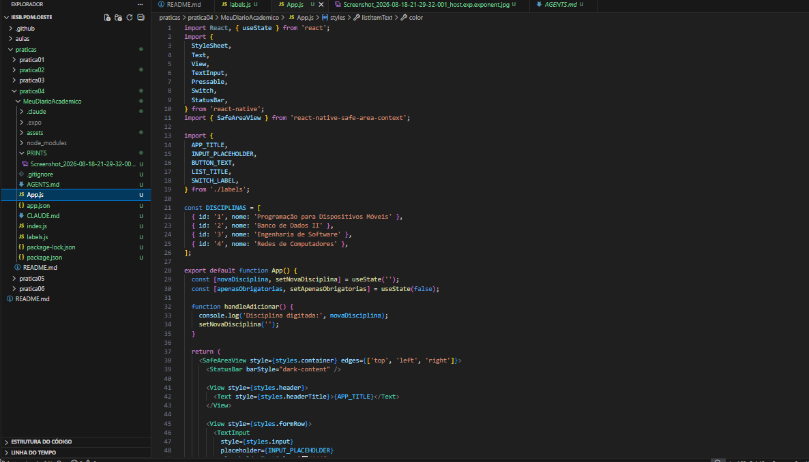
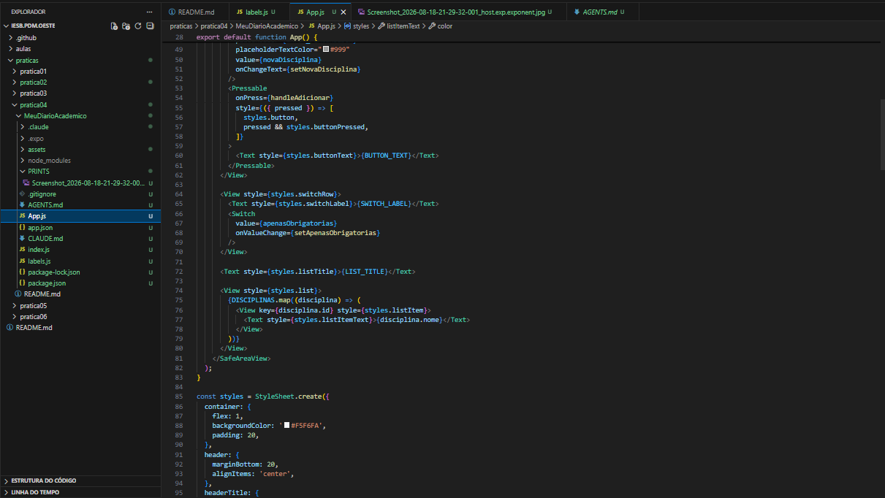
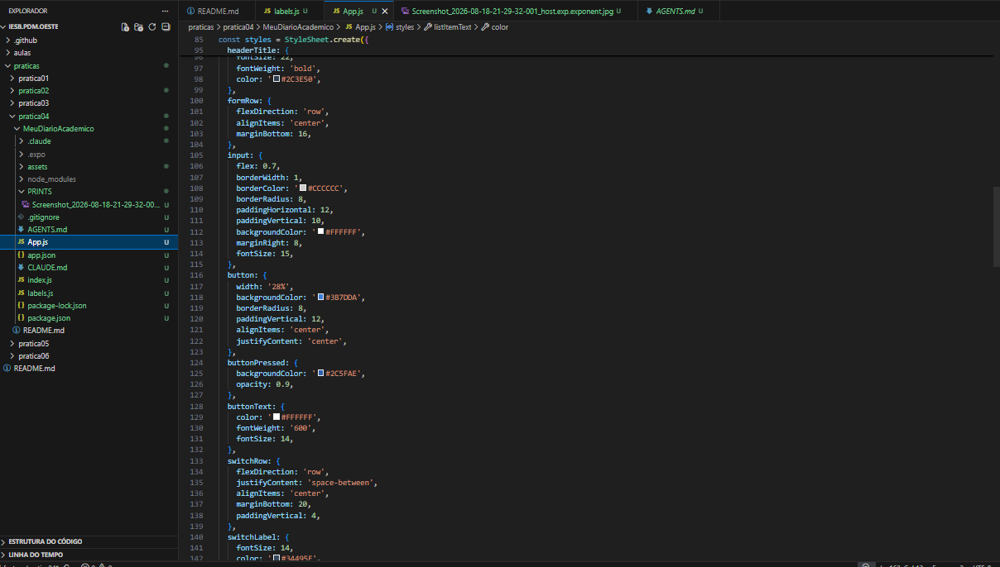
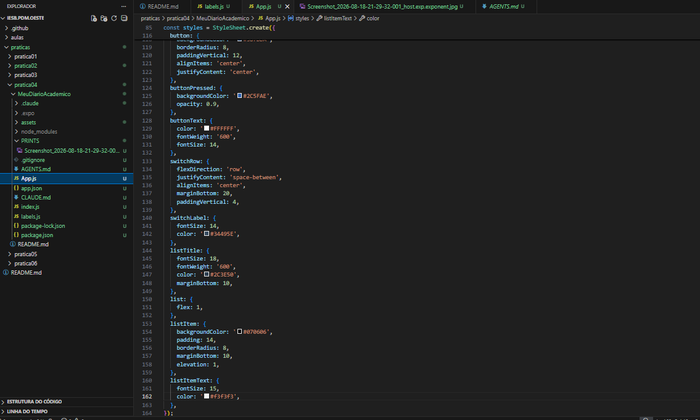
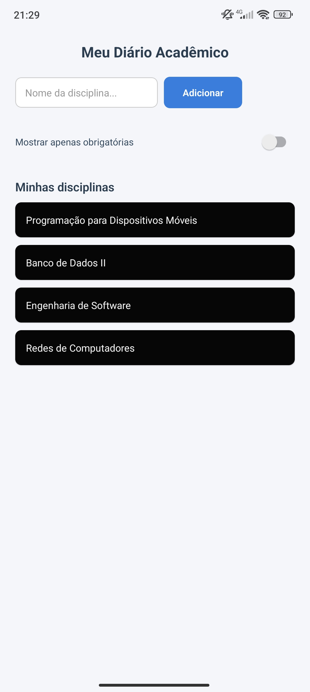

# Atividade 01 — MeuDiarioAcademico

Disciplina: Programação para Dispositivos Móveis (React Native / Expo)
Professor: Marcelo Alves Farias — IESB

## Sobre o app

Tela inicial de cadastro rápido de disciplinas do semestre. Contém:

- Cabeçalho com o título do app
- Linha (`flexDirection: 'row'`) com campo de texto (~70%) e botão "Adicionar" (~28%)
- Switch "Mostrar apenas obrigatórias" (ainda sem filtro real)
- Lista estática "Minhas disciplinas", renderizada com `.map`

## Comando usado para criar o projeto

```bash
npx create-expo-app@latest MeuDiarioAcademico --template blank
```

Depois foi instalada a lib de área segura recomendada pelo Expo:

```bash
npx expo install react-native-safe-area-context
```

## Como rodar

```bash
cd MeuDiarioAcademico
npm install
npx expo start
```

## Organização de código (import/export)

Todos os textos da tela (título, placeholder, texto do botão, título da
lista, rótulo do switch) ficam centralizados em `labels.js` e são
importados em `App.js` via `import { ... } from './labels'`.

## Decisões de layout (Flexbox)

- **container**: `flex: 1` para ocupar toda a tela.
- **header**: `alignItems: 'center'` para centralizar o título.
- **formRow**: `flexDirection: 'row'` para input e botão lado a lado;
  `alignItems: 'center'` para alinhar verticalmente os dois.
- **input**: `flex: 0.7` (~70% da linha).
- **button**: `width: '28%'` (uso de largura percentual).
- **switchRow**: `justifyContent: 'space-between'` para separar rótulo e switch.
- **list**: `flex: 1` para ocupar o espaço restante.

## Prints da tela

## Prints da tela







## Link do Pull Request

> Cole aqui o link do PR depois de criá-lo no GitHub.